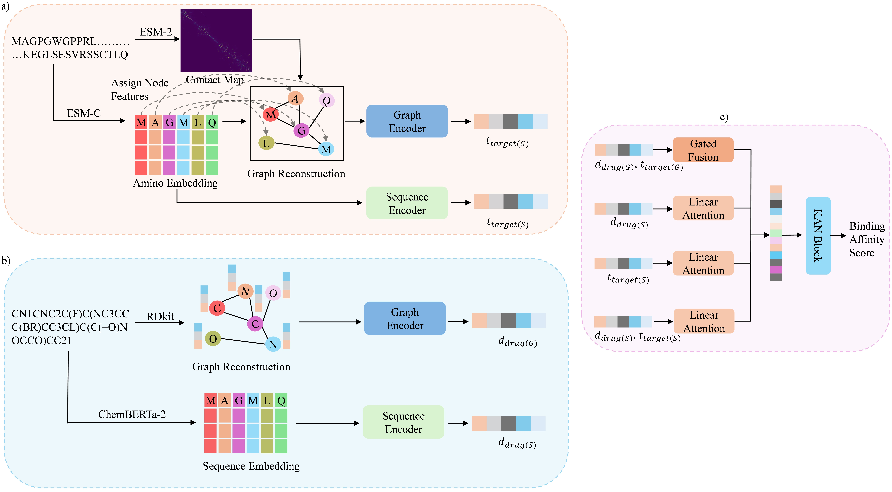

<h1 id="kanpm-dta">KANPM-DTA: Improving Drug-Target Affinity Prediction with Kolmogorov-Arnold Networks and Pre-trained Models</h1>

  <!-- Adjust width as needed (e.g., 800–1100) -->
  

<em>Figure 1. The proposed KANPM-DTA model architecture. (A) Graph and sequence-based protein feature encoding. (B) Graph and sequence-based drug 
feature encoding. (C) Adaptive feature learning between drug and protein graph-sequence features.</em>

<h2 id="requirements">Requirements</h2>
<ul>
  <li>Python==3.9.21</li>
  <li>numpy==2.0.2</li>
  <li>pandas==2.2.3</li>
  <li>torch==2.6.0</li>
  <li>transformers==4.49.0</li>
  <li>rdkit==2024.3.2</li>
  <li>fair-esm==2.0.0</li>
</ul>

<h2 id="clone-repository">Clone Repository</h2>
<pre><code>git clone https://github.com/khanonuvov/KANPM-DTA.git
cd KANPM-DTA
</code></pre>

<h2 id="Generate Pretrained Models">Generate Pretrained Models</h2>

For each dataset (<code>davis</code>, <code>kiba</code>, <code>metz</code>, <code>bindingdb</code>, <code>Lung Cancer Test</code>) run these three commands or download the pretrained models from <a href="https://www.kaggle.com/datasets/khanonuvov/kanpm-dta-pretrained-models"><code>here</code></a>.

<pre><code>python pretrained/chemberta_pretraiend.py</code></pre>
<pre><code>python pretrained/esmC_pretraiend.py</code></pre>
<pre><code>python pretrained/esm2_map.py</code></pre>

<h2 id="Generate Warm & Cold-start Datasets">Generate Cold-start Datasets</h2>
<pre><code>python code/cold_split.py</code></pre>

<h2 id="Train the Model">Train the Model</h2>
<pre><code>python code/train.py</code></pre>

<h2 id="Prediction">Prediction</h2>
<pre><code>python code/pred.py</code></pre>

<h2 id="citation">Citation</h2>

  If you find our paper or code useful in your research, please consider citing:

<pre><code>@article{10.1093/bib/bbag112,
  author  = {Rakib, MD Youshuf Khan and Alamin, Muhammad Habibulla and Li, Jiamu and Mamun, Sheikh Sohan and Gobena, Kaleb Amsalu and Ren, Shengbing},
  title   = {KANPM-DTA: improving drug–target affinity prediction with Kolmogorov–Arnold networks and pretrained models},
  journal = {Briefings in Bioinformatics},
  volume  = {27},
  number  = {2},
  pages   = {bbag112},
  year    = {2026},
  month   = {03}
}</code></pre>

<h2 id="contact">Contact</h2>

  For inquiries, please contact
  <strong>MD Youshuf Khan Rakib</strong> (Email: 
  <a href="mailto:mdkhan@link.cuhk.edu.cn">khanushuf4619@csu.edu.cn</a>).

